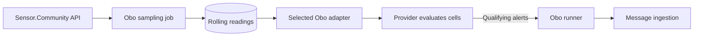

# Air Quality Monitoring

## Overview

Sensor.Community readings can produce `air-quality` alerts with a grid-cell polygon for the map. Obo samples outdoor PM2.5 and PM10 readings. The published `@oboapp/source-sensor-community` package evaluates stored readings for each locality. [Sensor.Community](https://sensor.community/) · [Provider package](https://github.com/oboapp/sources/tree/source-sensor-community-v0.1.0/packages/source-sensor-community)

The upstream demo selects the Sensor.Community evaluator as an emergent source. Terraform also creates the separate sampling job when `gcs_generic_bucket` is configured. [Demo job selection](../../ingest/terraform/source-jobs.bg.sofia.json) · [Terraform resources](../../ingest/terraform/main.tf)

## How it works

1. The Obo fetch job requests readings within the locality bounds and checks coordinates, pollutant values and indoor-sensor flags. The readings store deduplicates observations by sensor ID and timestamp and keeps the last 24 hours. [Sampling job](../../ingest/air-quality-fetch.ts) · [Readings storage](air-quality-storage.md)
2. The Obo adapter supplies the locality bounds and read-only access to the last four hours of measurements. The provider groups readings into roughly 4 km cells. It drops invalid values and concentrations above 999.9 μg/m³. For cells with four or more remaining readings, it applies a per-pollutant interquartile range filter. [Source adapter](../../ingest/crawlers/sensor-community/index.ts)
3. The provider calculates a NowCast index for each two-hour half. The current half must include three distinct sensors and at least one observation within the last 45 minutes. One populated hourly bin meets the 50% coverage threshold for a two-hour half. For each qualifying alert the provider returns an identifier, text, timespan and cell polygon. Obo's runner skips known identifiers and saves new alerts for ingestion. [Tagged evaluator](https://github.com/oboapp/sources/blob/source-sensor-community-v0.1.0/packages/source-sensor-community/src/index.ts) · [Source packages and adapters](source-packages.md)

## Alert Types

The 4-hour evaluation window is split into two non-overlapping halves: a **previous half** (t−4h to t−2h) and a **current half** (t−2h to now).

| Alert Type    | Condition                         | Meaning                                          |
| ------------- | --------------------------------- | ------------------------------------------------ |
| **Immediate** | Current half EAQI ≥ 5 (Very Poor) | Air quality is very poor right now               |
| **Sustained** | Both halves EAQI ≥ 4 (Poor)       | Air quality has been poor for an extended period |

Each alert is created as a source document with the grid cell's polygon geometry, the `air-quality` category, and a timespan covering the current evaluation half.

## AQI Scale

The package uses the following historical EAQI concentration bands and Bulgarian labels. It interpolates within each band and uses the higher of the two pollutant indices. [Index calculation](https://github.com/oboapp/sources/blob/source-sensor-community-v0.1.0/packages/source-sensor-community/src/aqi.ts)

| EAQI | Level                              | PM2.5 (μg/m³) | PM10 (μg/m³) |
| ---- | ---------------------------------- | ------------- | ------------ |
| 1    | Добро (Good)                       | 0–10          | 0–20         |
| 2    | Задоволително (Fair)               | 10–20         | 20–40        |
| 3    | Умерено (Moderate)                 | 20–25         | 40–50        |
| 4    | Лошо (Poor)                        | 25–50         | 50–100       |
| 5    | Много лошо (Very Poor)             | 50–75         | 100–150      |
| 6    | Изключително лошо (Extremely Poor) | ≥75           | ≥150         |

## Scheduling

The default sampling schedule is every 15 minutes. The evaluator follows the selected emergent workflow, which runs every 30 minutes from 07:00 through 22:30 in `Europe/Sofia` by default. It also runs in the full workflow. [Workflow schedules](cloud-workflows.md)

## Configuration

Both the ingest package (for the fetch job and crawler) and the web package (for the `/air-quality` monitoring page) read from environment variables. Key settings:

| Variable | Package | Required | Description |
|----------|---------|----------|-------------|
| `GCS_GENERIC_BUCKET` | ingest, web | Production | GCS bucket name for general-purpose file storage |
| `LOCAL_READINGS_PATH` | ingest, web | No | Local filesystem path for development (default: `./tmp/air-quality`) |
| `LOCALITY` | ingest | Yes | Locality identifier that determines the geographic bounds |
| `NEXT_PUBLIC_LOCALITY` | web | Yes | Locality shown on the `/air-quality` monitoring page and used as the default locality in `/api/air-quality/status` when no `locality` query parameter is provided |

See the `.env.example` files in each package for the full list of variables.

## Monitoring Page

The `/air-quality` page in the web app provides a real-time dashboard for the sensor.community pipeline. It displays:

- **Summary stats** — maximum EAQI, number of active sensors, and total message/notification counts.
- **Data freshness** — whether the most recent reading is fresh (within 45 minutes) or stale.
- **Grid cell map** — a Leaflet map with colour-coded ~4 km cells showing the current EAQI by area, computed from the last 4 hours of readings.
- **Recent alerts** — the latest messages produced by the crawler.

The page is currently only reachable by direct URL (`/air-quality`) — no link to it is published in the app navigation.

The page queries `/api/air-quality/status` every 60 seconds. The API reads the GCS readings file and computes NowCast AQI per grid cell. Results are cached for up to 5 minutes on a best-effort basis per running server instance, which helps reduce GCS reads but does not guarantee the same cache is shared across all requests (e.g. across serverless cold starts or multiple instances).

## Storage

See [Air Quality Storage](air-quality-storage.md) for details on how raw readings are persisted.
