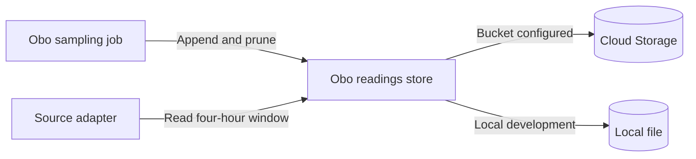

# Air Quality Storage

## Overview

Obo stores raw measurements in a rolling JSON file for each locality. The sampling job writes readings. The source adapter supplies the evaluator with a read-only window. Storage configuration and credentials stay in Obo. [Sampling job](../../ingest/air-quality-fetch.ts) · [Source adapter](../../ingest/crawlers/sensor-community/index.ts)

The store merges new readings with existing observations, deduplicates by sensor ID and timestamp, and prunes readings older than 24 hours. The evaluator requests the last four hours and receives observations with timestamps restored to JavaScript `Date` values. [Readings store](../../ingest/lib/air-quality/readings-store.ts)

## Production (GCS)

Readings are stored in a GCS bucket at `air-quality/{locality}/readings.json`. The bucket name is configured via the `GCS_GENERIC_BUCKET` environment variable. Each write overwrites the entire file with the updated rolling window.

## Development (Local Filesystem)

Outside production, when `GCS_GENERIC_BUCKET` is unset, readings fall back to the local filesystem at `{LOCAL_READINGS_PATH}/{locality}/readings.json`. The default path is `./tmp/air-quality`. Directories are created automatically on first write.

This enables full local development without GCS emulators or cloud credentials.

## Related

[Air quality monitoring, alert types and job selection](air-quality-monitoring.md)
