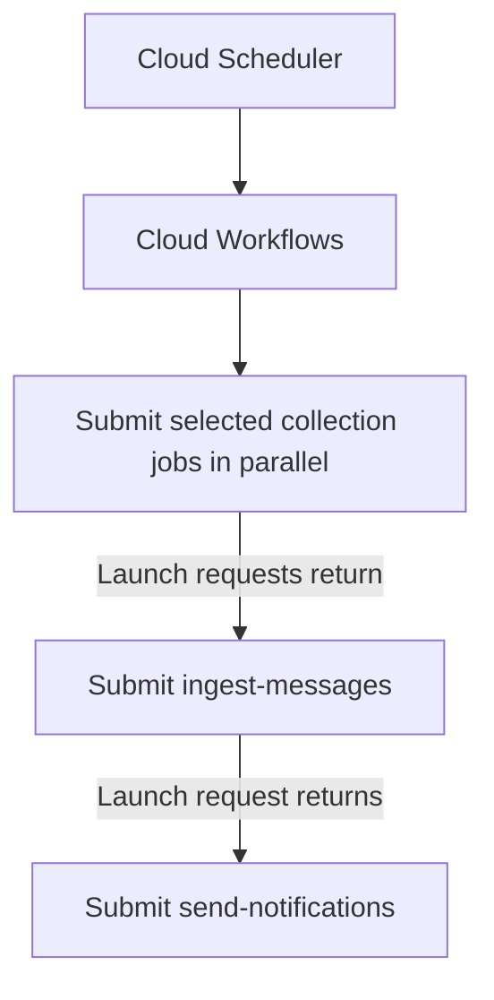

# Cloud Workflows Orchestration

Google Cloud Scheduler triggers a workflow that submits collection, ingestion and notification jobs to Cloud Run. Each job has its own execution and logs.

## Architecture



The workflow sends up to ten collection launch requests at a time. A successful `jobs.run` request creates a Cloud Run execution. The templates continue after the HTTP requests return, so collecting, ingesting and notifying can overlap. Check each Cloud Run execution for its outcome. [All-source workflow](../../ingest/terraform/workflows/all.yaml.tftpl) · [Emergent workflow](../../ingest/terraform/workflows/emergent.yaml.tftpl) · [Cloud Run jobs.run](https://docs.cloud.google.com/run/docs/reference/rest/v1/namespaces.jobs/run)

### Two Workflow Types

1. **Emergent Workflow** (`pipeline-emergent`)
   - **Crawlers**: A subset of sources that publish short-lived disruptions (utility outages, emergency works)
    - **Schedule**: Every 30 minutes in the configured scheduler timezone
   - **Use case**: Short-lived disruptions requiring frequent updates

2. **All Workflow** (`pipeline-all`)
   - **Crawlers**: All currently deployed crawlers
    - **Schedule**: 3 times daily in the configured scheduler timezone
   - **Use case**: Long-term construction/repair projects and municipal announcements from district administrations

The scheduler timezone is configured through Terraform (`schedule_timezone`).

Example profile (Sofia deployment): emergent runs every 30 minutes between 7:00 and 22:30, and full runs at 10:00, 14:00, and 16:00.

For adapting schedules and locality configuration for a new city instance, see [Deploying oboapp for a New City](../setup/new-locality-instance.md).

## Workflow Execution Flow

### Step 1. Launch selected collection jobs

Selected source jobs run in parallel. Within each job, Obo's runner checks the identifiers supplied by the package, fetches new items one at a time and saves complete raw records through `@oboapp/db`.

If Cloud Run rejects a launch, the workflow logs the failed request and continues submitting other jobs.

### Step 2. Launch ingestion

After the collection launch requests return, the workflow submits `ingest-messages`. The job processes the records available when it runs:

- Processes all unprocessed source documents in Firestore
- Performs AI categorization (for sources without precomputed GeoJSON)
- Geocodes addresses/streets using Google Maps, Overpass, and Cadastre APIs
- Creates messages with GeoJSON geometries
- Marks messages as `finalized`

A rejected ingest launch is logged before the workflow submits the notification job.

**Handled geocoding misses**: Not every message-level geocoding problem is a workflow failure. Messages that cannot produce valid geometry can still be finalized without GeoJSON and inspected later through `ingestErrors`. Temporary Overpass saturation is expected to surface mainly as warnings unless it aborts the job.

### Step 3. Launch notifications

After the ingest launch request returns, the workflow submits `send-notifications`. The job processes finalized messages available at execution time:

- Matches finalized messages to user notification preferences
- Sends push notifications via Firebase Cloud Messaging
- Updates last notification timestamp for users

If Cloud Run rejects the notification launch, the workflow logs the error and completes.

## Monitoring Workflow Executions

### Cloud Console

1. Navigate to **Workflows** in Google Cloud Console
2. Select workflow: `pipeline-emergent` or `pipeline-all`
3. Click **Executions** tab to see recent runs
4. Click on any execution to see:
   - Execution graph (visual representation of steps)
   - Step-by-step logging with timestamps
   - Input/output of each step
   - Error messages for failed steps

### Individual Task Logs

Each Cloud Run job execution has separate logs:

1. Navigate to **Cloud Run** → **Jobs**
2. Select the relevant job
3. Click **Logs** tab
4. Filter by execution time to find logs from specific workflow run

### Checking Scheduler Status

Cloud Scheduler triggers workflows on schedule:

```bash
# List all scheduled jobs
gcloud scheduler jobs list --location=europe-west1

# View specific schedule
gcloud scheduler jobs describe pipeline-emergent-schedule \
  --location=europe-west1
```

## Manual Workflow Execution

### Trigger Workflow Manually

Useful for testing or emergency re-runs:

```bash
# Execute emergent workflow
gcloud workflows execute pipeline-emergent --location=europe-west1

# Execute all workflow
gcloud workflows execute pipeline-all --location=europe-west1
```

The command returns an execution ID immediately. Use it to check status:

```bash
# Check execution status
gcloud workflows executions describe EXECUTION_ID \
  --workflow=pipeline-emergent \
  --location=europe-west1
```

### List Recent Executions

```bash
# View last 10 executions
gcloud workflows executions list \
  --workflow=pipeline-emergent \
  --location=europe-west1 \
  --limit=10
```

## Failure scenarios

| Symptom | Where to check |
| --- | --- |
| A job has no execution | Inspect the workflow step for a rejected launch request. Check the job name, region and the workflow service account's permissions. |
| A source job starts and fails | Open the Cloud Run execution for that source. Check provider access and the saved, skipped and failed item counts. Other launched jobs continue independently. |
| Multiple sources fail to save records | Check their Cloud Run logs for a shared storage error. Ingest can still process records from earlier scans. |
| A source saves items after ingest has read the queue | Check the next ingest execution for those pending records. The same timing applies to messages finalized after the notification job reads its queue. |
| Ingest or delivery fails | Inspect `ingest-messages` for processing errors and `send-notifications` for delivery errors. Check the affected service and rerun the relevant job after recovery. |

## Emergency Fallback: Legacy Pipeline Jobs

If Workflows are completely unavailable (rare GCP service outage), use the legacy monolithic pipeline jobs:

```bash
# Run emergent pipeline (all-in-one job)
gcloud run jobs execute pipeline-emergent --region=europe-west1 --wait

# Run full pipeline (all-in-one job)
gcloud run jobs execute pipeline-all --region=europe-west1 --wait
```

**Note**: These jobs are marked DEPRECATED and are NOT scheduled. They perform the same work as workflows but in a single container execution with combined logging.

## Alerting

Workflow logs record failed launch requests. Cloud Run job logs record errors during collection, ingestion and notification. For configured alert policies and where to investigate, see the [error monitoring guide](error-monitoring.md).

## Workflow Source Files

Workflow definitions are version-controlled under `ingest/terraform/workflows/`. Changes require Terraform deployment:

```bash
cd ingest/terraform
terraform plan
terraform apply
```

## Adding a source

Publish the provider package and pin its exact version in `ingest/package.json`. Add its Obo entrypoint and source definition, select it in `shared/src/sources.ts`, and add its job to `ingest/terraform/source-jobs.<locality>.json`. Terraform uses the locality job map to generate the workflows. [Source package integration](source-packages.md)

## Related Documentation

- [Geocoding](../../ingest/geocoding/README.md) - How addresses/streets are geocoded during ingest
- [Error Monitoring](./error-monitoring.md) - How Cloud Logging, alerting, and Sentry divide responsibility
- [Message Filtering](./message-filtering.md) - AI categorization and data extraction
- [Terraform Setup](../../ingest/terraform/README.md) - Infrastructure deployment guide
