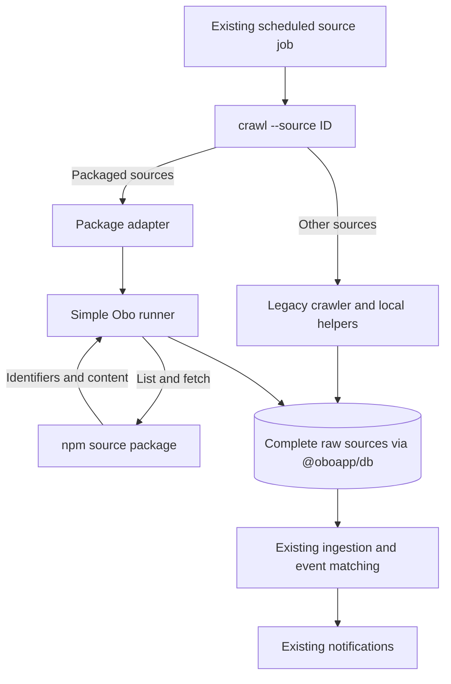

# Source package migration

Tracking: [#586](https://github.com/oboapp/oboapp/issues/586). Packages live in [oboapp/sources](https://github.com/oboapp/sources). Prefer a small, readable integration over infrastructure that has no demonstrated need.

## Current transition state

Triaditsa, Oborishte, Slatina, Toplo, Lozenets, Studentski, Sredets, Ilinden, Nadezhda, Iskar, Mladost and Vrabnitsa use published source packages. Triaditsa was first piloted in [vbuch/oboapp PR #29](https://github.com/vbuch/oboapp/pull/29). Both collection paths remain in use during migration.

| Responsibility | Legacy sources | Packaged sources |
| --- | --- | --- |
| Provider parsing and content conversion | `ingest/crawlers/{id}/` and local helpers | Versioned source packages in the sources repository |
| Database lookup and raw persistence | Legacy crawler helpers in Obo | `ingest/sources/run-source.ts` in Obo |
| Scheduled entrypoint | Existing `crawl --source {id}` job | Same job and command, with an adapter in `crawlers/{id}/index.ts` |
| Web catalog and deployment selection | Instance source assembly (`shared/src/sources.ts`) and Terraform | The same instance assembly and Terraform configuration |
| Processing after collection | Existing raw-source ingestion, event matching, notifications | The same processing pipeline |

The ingest package pins these published versions:

| Source | Package | Version |
| --- | --- | --- |
| Triaditsa | `@oboapp/source-triaditsa-org` | `0.2.0` |
| Oborishte | `@oboapp/source-rayon-oborishte-bg` | `0.1.0` |
| Slatina | `@oboapp/source-so-slatina-org` | `0.1.0` |
| Toplo | `@oboapp/source-toplo-bg` | `0.1.0` |
| Lozenets | `@oboapp/source-lozenets-sofia-bg` | `0.1.0` |
| Studentski | `@oboapp/source-studentski-bg` | `0.1.0` |
| Sredets | `@oboapp/source-sredec-sofia-org` | `0.1.0` |
| Ilinden | `@oboapp/source-rayon-ilinden-bg` | `0.1.0` |
| Nadezhda | `@oboapp/source-nadezhda-org` | `0.1.0` |
| Iskar | `@oboapp/source-raioniskar-bg` | `0.1.0` |
| Mladost | `@oboapp/source-mladost-bg` | `0.1.1` |
| Vrabnitsa | `@oboapp/source-vrabnitsa-org` | `0.1.0` |

Each source uses one collection path. Text sources continue through AI extraction and geocoding; sources with precomputed GeoJSON use their existing processing path.

The current deployment image includes legacy crawler code. Developers update the source catalog and Terraform lists by hand. A later stage will build these lists from installed packages and include only selected sources in the image.

## Scheduled source runner

`runSource` in `ingest/sources/run-source.ts` receives the database from `getDb()`, package metadata, and a `CreateSource` factory. Load environment variables before obtaining the database. The runner validates `LOCALITY` against the package metadata and creates one source instance for the scan.

The flow is: list candidates, skip identifiers already stored, fetch new content, validate it, and save a complete raw document. Pagination stays in memory within the run. Items are processed sequentially so sources can reuse browser sessions and enforce their provider's rate limits. The source is closed in `finally`.

Historical base64 and MD5 lookups remain supported. Identifiers are preserved byte for byte. A create-only write prevents overlapping scans from overwriting an existing raw record or resetting its processing state. Obo owns source ID, locality, URL, crawl timestamp, and `processed=false`; package content cannot override those fields. Dates and GeoJSON are converted to the existing raw-ingest representation. Invalid content never creates a partial raw record.

An individual lookup, fetch, validation, or save failure is logged and counted while other items continue. The caller receives saved/skipped/failed totals. Listing failures and repeated pagination cursors fail the run. A later scheduled scan starts listing again, skips successful items, and retries missing items that are still available. An item can be missed if it disappears before a successful fetch; this is an accepted limitation of the initial migration.

`discoverItems` lists candidates. `fetchItem` returns their content; full-content feeds and synthetic-identifier sources can supply it directly from listing context cached in the source instance. The runner handles both operations within the scheduled scan.

The migrated sources delegate from their existing entrypoints to their respective packages through the runner. Their Cloud Run jobs, schedules, catalog entries, and source identities stay unchanged. Other crawlers retain their existing implementation until their individual cutovers. Preserve each source's special legacy deduplication, including Sofia's title fallback, before switching it. Package upgrades never trigger refetching old identifiers.

Oborishte and Slatina use RSS for discovery and a reused Chromium browser for article details. Their package versions use Playwright 1.61.1. The ingest image must include the matching browser revision. Their handoff tests cover historical base64 and MD5 identifiers, repeat scans and retry after a page failure.

## Lozenets, Studentski and Sredets

These three sources use their published `0.1.0` packages through the existing scheduled entrypoints. Lozenets and Studentski discover articles from their RSS feeds. Sredets preserves its five category feeds, ordered discovery and 90-day cutoff. Its listing finishes before the runner starts saving articles, so a listing failure leaves no partial scan in storage.

The packages use `@oboapp/source-web-utils@0.1.0` for RSS fetching and Chromium article extraction. This helper owns Playwright 1.61.1. The image's browser check resolves Playwright through each provider's helper dependency and launches the installed Chromium revision as the production user.

`messageIngest/packaged-next-districts-handoff.test.ts` runs the published packages through their actual crawler entrypoints, raw storage and ingestion with simulated HTTP, browser and database boundaries. It covers literal URLs and MD5 identifiers, historical base64 records, repeat scans, listing failures and detail retries. Provider parsers and selectors are maintained in [oboapp/sources](https://github.com/oboapp/sources).

Run `pnpm --dir ingest crawl --source lozenets-sofia-bg`, `--source studentski-bg` or `--source sredec-sofia-org` with the normal ingest environment. Their regular schedules and `bg.sofia` locality remain in place. To roll back, revert this integration and redeploy the previous image. Existing stored identifiers remain compatible.

## Ilinden, Nadezhda and Iskar

These three sources use their published `0.1.0` packages through the existing scheduled entrypoints. Their `@oboapp/source-web-utils@0.2.0` dependency provides browser listing and detail collection. The integration pins the published source versions and their registry integrity values in the lockfile.

These sources preserve their browser listing selectors, literal anchor URLs and existing URL filters. Nadezhda deduplicates its listing. Titles, dates and content come from detail pages. Missing detail titles or content fail the item. Numeric Bulgarian dates retain the legacy parser, including current-time fallback for unparseable dates. Iskar's ISO-style provider dates currently use that fallback.

One browser is reused across the listing and article details. Each page closes after its attempt, and attempts are spaced by two seconds, including failures. The existing source IDs, `bg.sofia` locality, Cloud Run jobs and schedules remain in place. The image checks resolve Chromium through the new packages' helper dependency.

`messageIngest/packaged-browser-districts-handoff.test.ts` exercises the published packages through their actual entrypoints, raw storage and ingestion. It covers literal identifiers, historical base64 and MD5 records, repeat scans, listing failures, detail retries and per-item continuation. Captured provider parser contracts live in the sources repository.

Run `pnpm --dir ingest crawl --source rayon-ilinden-bg`, `--source nadezhda-org` or `--source raioniskar-bg` with the normal ingest environment. Each source keeps its existing command and scheduled job. To roll back, revert the integration and redeploy the previous image. Existing stored identifiers remain compatible.

## Mladost and Vrabnitsa

Mladost uses its published `0.1.1` package and Vrabnitsa uses `0.1.0` through the existing scheduled entrypoints. The source extractions were reviewed in [Mladost PR #22](https://github.com/oboapp/sources/pull/22) and [Vrabnitsa PR #23](https://github.com/oboapp/sources/pull/23). Their release records are [Mladost 0.1.1](https://github.com/oboapp/sources/releases/tag/source-mladost-bg-v0.1.1) and [Vrabnitsa 0.1.0](https://github.com/oboapp/sources/releases/tag/source-vrabnitsa-org-v0.1.0).

Mladost preserves the repair-listing card selectors, literal article URLs, detail-page title and body, and script/style cleanup. Bulgarian month-name dates use local midnight in the process timezone. When the visible date includes `Публикувано:`, the existing parser falls back to the scan time. The package preserves that behavior; publication-date correction is recorded in [#673](https://github.com/oboapp/oboapp/issues/673).

Vrabnitsa preserves its news-card selectors, literal article URLs, URL filters and duplicate order. Detail dates prefer the `datetime` attribute, then normalized visible text. Parsing strips the publication prefix and tries JavaScript date parsing followed by Bulgarian month names. Unparseable dates retain the current-time fallback. Body cleanup removes scripts, styles, article asides, paging, icons, button groups and navigation.

Mladost uses `@oboapp/source-web-utils@0.3.1` and Vrabnitsa uses `0.3.0`. Both helper versions own Playwright 1.61.1. One browser serves each scan, pages close after every attempt, and listing and detail attempts wait two seconds, including failures. The production image resolves Chromium through each provider's helper dependency and checks that it can render a page as the production user.

Mladost 0.1.1 rejects unsuccessful HTTP navigation responses before extracting a listing or article. A listing HTTP failure fails the scan. An article HTTP failure is counted while other items continue, and the next scheduled scan retries the missing item. Successful empty listings remain valid. Cloud Run access denials observed on 11 November 2026 are tracked in [#677](https://github.com/oboapp/oboapp/issues/677).

`messageIngest/packaged-joomla-districts-handoff.test.ts` runs the published packages through their actual entrypoints, raw persistence and ingestion with simulated browser and database boundaries. It covers literal identifiers, historical base64 and MD5 records, complete raw content, repeat scans, retries, per-item continuation and provider-specific dates. Mladost's HTTP 403 cases verify scan failure and article failure followed by retry. Parser and captured-page contracts live in the sources repository.

Run `pnpm --dir ingest crawl --source mladost-bg` or `--source vrabnitsa-org` with the normal ingest environment. The existing source IDs, `bg.sofia` locality, catalog metadata, Cloud Run jobs and schedules remain in place. To roll back, revert the integration and redeploy the previous image. Existing stored identifiers remain compatible.

## Toplo synthetic-identifier pilot

Toplo uses `@oboapp/source-toplo-bg@0.1.0` through its existing `toplo-bg` entrypoint. The package reads the incident JSON embedded in the public HTML listing over HTTP and caches it in one source instance. Synthetic URLs such as `https://toplo.bg/incidents/item-1` remain raw-record identifiers; the empty `deepLinkUrl` keeps them out of public detail links. Large geometry stays in the instance cache, outside the SDK discovery payload limit.

The adapter selects the runner's `legacy-toplo` validation profile to preserve the provider's title and publication-date strings, including empty titles and malformed dates. This profile is restricted to `toplo-bg`. Message, timespan, geometry and platform-field validation still apply. Invalid starts fall back to the scan time for timespans; invalid or missing ends fall back to the validated start.

The exported `crawl(true)` preview validates and counts listing items without initializing the database or checking historical records. Its `saved` count means items that would be saved. Normal scans skip historical base64 and MD5 records, use create-only writes, continue after individual failures and retry missing records on a later scan. An empty listing or a scan where every item fails makes the entrypoint fail.

Run `pnpm --dir ingest crawl --source toplo-bg` with the normal ingest environment. The existing `toplo` Cloud Run job, `bg.sofia` locality and emergent schedule remain in place. Roll back by reverting the Toplo integration commit and redeploying the previous image. Existing stored identifiers remain compatible.

`messageIngest/packaged-toplo-handoff.test.ts` exercises the published package through raw persistence and ingestion using frozen provider fixtures. Provider parser and builder tests live in [oboapp/sources](https://github.com/oboapp/sources/tree/main/packages/source-toplo-bg). Source-package Sonar analysis and coverage are tracked in [#663](https://github.com/oboapp/oboapp/issues/663).

## Trying the Triaditsa pilot

With the normal ingest environment configured (`LOCALITY=bg.sofia` and database credentials), run `pnpm --dir ingest crawl --source triaditsa-org`. This scan writes new raw records and logs saved/skipped/failed totals. Existing records should be skipped on a second run. Use the existing Triaditsa job as the single scheduled entrypoint.

The source package uses the same RSS Accept header as the shared RSS fetcher. Its own tests compare output against a fixture captured from the legacy parser and Markdown conversion. To roll back, revert the pilot switch commit and redeploy the previous entrypoint. Existing stored records remain valid.

Version `0.2.0` collects the News feed and `https://triaditza.org/feed/?post_type=announcements`. It deduplicates shared URLs, preserves publication dates and document links, and removes embedded styles and scripts from Markdown. Obo's handoff test covers both feeds reaching ingestion and repeat scans skipping stored items.

## Moving the next source

1. Add contract tests for the source's existing identifiers, content, locality, schedule, and historical lookup rules. Include provider fixes made in the deployment fork.
2. Move the code that reads and converts provider data into the package. Provide separate runtime and metadata entrypoints so the web app can load catalog metadata on its own. Keep database access in Obo.
3. Publish and check the reviewed package. Set its exact version in an Obo integration PR. Replace the existing entrypoint with an adapter that calls the package through the runner. Then remove the old local source code.
4. Test the full path from the package through raw storage to ingestion. Check that known items are skipped and failures are handled. Keep the existing scheduled job.
5. Deploy the integration, inspect the source job's saved/skipped/failed totals, and confirm repeat scans skip known records. Record the migrated source in this guide and update diagrams when the architecture changes.

Parser fixes belong in the source package; runner and ingestion fixes belong in Obo. Package publication and Obo deployment are separate steps. Once all sources use packages and share one configuration, update this guide and its diagrams to show the completed migration.

## Existing atomic database primitive

`DbClient.compareAndUpdate(collection, id, tokenField, expectedToken, data)` was added before the runner was simplified. The runner does not use it. It remains available for callers that actually require an atomic string-token comparison.

Firestore compares and writes in a transaction; MongoDB uses a conditional update without upsert. A missing record or stale token returns false. In dual-write mode only the primary decides success, and successful updates replicate best-effort. This is not a distributed transaction. Adapter tests mock the storage boundaries; they are not database-backed concurrency tests.
