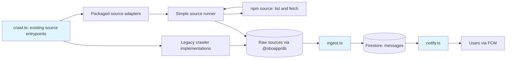

# Ingest Pipeline

Data collection and processing pipeline for OboApp. Collects infrastructure disruption notices from public sources (water, heating, road repairs) across Sofia, processes them into geocoded GeoJSON, and delivers notifications to interested users.

## ⚠️ WORKSPACE SETUP

This package is part of a pnpm workspace. **Run `pnpm install` at the repository root**, not in this directory.

The shared package (@oboapp/shared) is built automatically during workspace installation via postinstall hook.

## Pipeline Overview



During the [source-package transition](../docs/features/source-packages.md), the existing command and Cloud Run jobs run either a legacy crawler or an adapter to a published source package. The transition guide describes migration status and deployment steps. Provider collection for packaged sources lives in the sources repository; remaining legacy implementations stay in `crawlers/`. Both paths feed the same processing pipeline. Packages supply data. Obo's runner handles deduplication, validation, and persistence: it skips known items, checks new content, and saves complete records.

The `crawl` and `pipeline` commands share a [runtime registry](sources/registry.ts) derived from `SOURCES` in `shared/src/sources.ts`. Help lists selected sources, and `crawl --source` rejects unselected IDs even when their implementation directories exist. `pipeline --all` runs all selected sources; `pipeline --emergent` runs selected sources marked `emergent: true`.

The production build clears `dist` and compiles selected source entrypoints and their imports alongside common application code. The image omits the raw crawler source tree. Docker prepares separate production manifests and matching lockfile importer entries, then installs selected provider dependencies into a fresh layer with a frozen production install. Source-package browser checks follow those selected packages and their declared Playwright dependencies. The builder still installs the full development workspace. See the [production dependency guidance](../docs/features/source-packages.md#preparing-production-dependencies) for the staging process and remaining verification work.

## Components

- **[crawlers/](crawlers/README.md)** - Automated scrapers that fetch raw data from external sources
- **[sources/](sources/run-source.ts)** - Simple scheduled runner for packaged sources, including Toplo's synthetic-identifier listing
- **[messageIngest/](messageIngest/README.md)** - Processing pipeline: AI extraction → geocoding → GeoJSON conversion
- **[geocoding/](geocoding/README.md)** - Geocoding services (Google, Overpass, Cadastre, GTFS) with persistent cache
- **[notifications/](notifications/README.md)** - Geographic matching and push notification delivery

## Usage

```bash
# Run a selected source
pnpm crawl --source <source-id>

# List selected sources
pnpm crawl --help

# Sync GTFS bus stop data
pnpm gtfs-stops

# Process all sources into messages
pnpm ingest

# Send notifications for new messages
pnpm notify

# Run emergent pipeline (selected emergent sources + ingest + notify)
pnpm pipeline:emergent

# Run full pipeline (all selected sources + ingest + notify)
pnpm pipeline:all

# Generate geocoding frequency report (uploads to GCS)
pnpm geocode-cache:report

# Pre-cache a geocoded address/street from an existing message
pnpm geocode-cache:add --message <id> --address "..." --type pin|street

```

## Pipeline Schedules

Cloud Scheduler invokes the `pipeline-emergent` and `pipeline-all` Workflows defined in [Terraform](terraform/main.tf). Each workflow submits its configured source jobs in parallel, then submits separate `ingest-messages` and `send-notifications` jobs. The source jobs come from the selected locality job JSON; the emergent workflow filters them by their `emergent` flag. Keep this selection aligned with `shared/src/sources.ts`.

The manual `pipeline:emergent` and `pipeline:all` commands above run source collection sequentially in one process, followed by ingestion and notification matching.

Configure `schedules` and `schedule_timezone` in your instance's Terraform variables. The [defaults](terraform/variables.tf) use `Europe/Sofia`, including daylight saving time:

| Scheduled workflow or job | Default schedule | Purpose |
| --- | --- | --- |
| `pipeline-emergent` | Every 30 minutes from 07:00 to 22:30 | Dispatch emergent source jobs, ingestion and notifications |
| `pipeline-all` | Daily at 10:00, 14:00 and 16:00 | Dispatch all selected source jobs, ingestion and notifications |
| `gtfs-sync` | Monday at 03:00 | Refresh bus stop coordinates for geocoding |
| `educational-facilities-sync` | Monthly on the 1st at 04:00 | Refresh school and kindergarten coordinates for geocoding |

Terraform also schedules the notification heartbeat and configured reports. Report jobs depend on instance settings, such as the storage bucket and billing export configuration.

## Deployment

Dockerized for Google Cloud Run Jobs. See `Dockerfile` and `terraform/` directory.

## Testing Toolchain Note

Both ingest and web use Vitest 4. Ingest runs with the ESM configuration in `vitest.config.mts`; `vitest.config.ts` re-exports it for compatibility. Use `pnpm --dir ingest test:run` for the normal crawler and pipeline suite.

## AI Prompt Evaluation

The three AI pipeline prompts (filter-split, categorize, extract-locations) are evaluated using [promptfoo](https://www.promptfoo.dev/). Eval configs live in `prompts/__evals__/`.

**Prerequisites:** `GOOGLE_AI_API_KEY` and `GOOGLE_AI_MODEL` env vars must be set (same as for integration tests).
