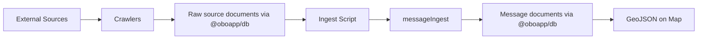

# Crawlers

This directory contains the crawler entrypoints: the functions called by the collection commands. During the [source-package transition](../../docs/features/source-packages.md), each directory holds either a legacy crawler or an adapter to a published source package. Triaditsa, Oborishte, Slatina, Toplo, Lozenets, Studentski, Sredets, Ilinden, Nadezhda, Iskar, Mladost and Vrabnitsa call their published npm packages through Obo's runner. Both paths save raw records through `@oboapp/db`.

## How They Work

Each legacy crawler:

1. Fetches raw data from its source (web scraping or API)
2. Extracts structured information (title, content, dates, URLs)
3. Stores documents in the sources collection through `@oboapp/db` with a `sourceType` identifier
4. Tracks processed URLs to avoid duplicates

For packaged sources, maintain the parser and source-content tests in [oboapp/sources](https://github.com/oboapp/sources). Maintain the runner, deduplication rules, persistence tests, and job entrypoints in this repository. Existing directory names and `crawl --source` commands remain for compatibility during migration.

## Pre-refactor contract tests

The baseline for [#579](https://github.com/oboapp/oboapp/issues/579) protects current behavior before the independently packaged sources migration in [#586](https://github.com/oboapp/oboapp/issues/586). Run from the repository root:

```sh
pnpm --dir shared build
pnpm --dir db build
pnpm --dir ingest test:run crawlers
pnpm --dir ingest test:run messageIngest/source-handoff.test.ts
pnpm --dir ingest test:run messageIngest/packaged-hybrid-handoff.test.ts
pnpm --dir ingest test:run messageIngest/packaged-toplo-handoff.test.ts
pnpm --dir ingest test:run messageIngest/packaged-next-districts-handoff.test.ts
pnpm --dir ingest test:run messageIngest/packaged-browser-districts-handoff.test.ts
pnpm --dir ingest test:run messageIngest/packaged-joomla-districts-handoff.test.ts
```

All source directories, including currently unselected sources, have crawl-entrypoint coverage. `shared/source-inventory.test.ts` checks the explicit inventory against the implementation directories. Add a real crawl contract suite and update that inventory when adding a source; parser tests alone are insufficient.

| Suite | Contract protected |
| --- | --- |
| Each source's `index.contract.test.ts` (Sofia uses `index.test.ts`) | Identity/locality wiring, output or shared-helper delegation, and source-specific failure behavior |
| `shared/persistence-contract.test.ts` | Legacy base64 and MD5 lookups, sequential idempotency, no overwrites, validation, categories, processing state |
| `shared/orchestration-contract.test.ts` | Website/full-feed/hybrid deduplication, persistence, failure continuation and browser ownership |
| `messageIngest/source-handoff.test.ts` | Actual full-feed and NIMH crawler output through persistence and `from-sources.ingest()` |
| `messageIngest/packaged-hybrid-handoff.test.ts` | Oborishte and Slatina packages through persistence and ingestion, historical lookups and retry |
| `messageIngest/packaged-toplo-handoff.test.ts` | Toplo package through persistence and ingestion, literal synthetic identifiers, legacy fields and historical lookups |
| `messageIngest/packaged-next-districts-handoff.test.ts` | Lozenets, Studentski and Sredets packages through persistence and ingestion, historical lookups, listing failures and retry |
| `messageIngest/packaged-browser-districts-handoff.test.ts` | Ilinden, Nadezhda and Iskar published packages through persistence and ingestion, detail metadata, historical lookups, listing failures and retry |
| `messageIngest/packaged-joomla-districts-handoff.test.ts` | Mladost and Vrabnitsa published packages through persistence and ingestion, literal identifiers, provider dates, historical lookups, failures and retry |

Tests use frozen time, local fixtures and mocked browser/network/storage boundaries. `__mocks__/source-contract.ts` provides a small stateful mock of the `@oboapp/db` sources repository; it is not a database emulator. Shared helper tests execute actual persistence code. Legacy wrapper suites invoke the exported crawler and its detail callback; packaged-source suites exercise the adapter and the package handoff. Custom suites retain real builders and transforms. AQI calculations and parsers retain their own unit suites. No credentials, browser downloads, provider access, or emulator are needed.

The handoff smoke suite stops at `messageIngest`, explicitly seeding downstream completion state for repeat-crawl checks. Actual message creation and processed-state updates are covered by `messageIngest/db/store-incoming-message.test.ts`; precomputed-geometry processing is covered by `messageIngest/index.test.ts`. The smoke suite does not claim to exercise AI or event matching.

Preserve literal identifiers byte-for-byte. Do not derive expected identifiers using the production builder. Freeze only shared contract fields, not entire HTML responses or log output. Existing records remain known even when `processed=false`, provider content changes, or a package is upgraded. NIMH's structured-warning hash remains part of its identifier, so a changed warning can still produce a different identifier.

During #586, keep historical lookup/no-overwrite tests in Obo and reuse identifier/content fixtures for `discoverItems`/`fetchItem`. Replace obsolete wrapper call assertions as entrypoints change. Triaditsa's handoff test runs the actual package with simulated HTTP responses and storage. Runner tests cover later retries and scans that run at the same time. The legacy helper checks for an existing record before writing. It guarantees sequential idempotency: repeated scans avoid duplicates when they run one at a time. Queues and saved discovery checkpoints are deferred.

Known boundaries: this baseline does not assert universal failure behavior. Some legacy sources abort on a lookup/provider failure, while shared RSS skips unreadable items. Legacy browser cleanup is not certified on every exceptional path. Packaged sources close their source instance through the runner's `finally` block; Toplo uses HTTP. Review remaining legacy cleanup changes separately.

Before migrating Sofia, preserve its URL aliases, exact historical-title fallback, and lookup-failure handling. A failed URL lookup skips the item. Its contract suite protects these rules, feed/query failure propagation, and detail-failure continuation. The ingestion tests also protect the empty-message completion guard in `from-sources`.

Before considering a PR ready, check every applicable CI job and available Sonar findings for changed files, including the actual quality gate. State when Sonar results are unavailable. A green gate does not necessarily mean there are no new issues. Keep test declarations explicit in each `.test.ts` file so static analysis can recognize them; shared mock/assertion support belongs under `__mocks__`.

## Screenshot Baselines (Required)

Every crawler directory should include baseline screenshots for easier maintenance when source site design changes.

- Preferred files: `_entry.png` (listing/index page) and `_message.png` (detail page)
- Place screenshots directly in `ingest/crawlers/{source-name}/`
- Source-specific names are allowed when structure differs
- Refresh screenshots whenever selectors/parsers are updated after site redesign

Tip: full-page capture tools such as GoFullPage can speed up baseline creation.

### Crawler Architecture

Legacy district crawlers use the shared WordPress helpers in `ingest/crawlers/shared/` for browser sessions, listing and detail extraction, duplicate checks and raw persistence. Packaged district sources use helpers in the sources repository for provider collection, while Obo's runner owns duplicate checks and persistence.

Crawlers that fetch from APIs (utility companies, weather services) have custom implementations tailored to each data source.

### Markdown Text Handling

Crawlers handle message formatting differently based on whether they provide precomputed GeoJSON:

**Crawlers with precomputed GeoJSON** (utility APIs, weather services):

- Skip the AI filtering and extraction pipeline
- Must store formatted text in both `message` and `markdownText` fields
- **City-wide messages**: Set `cityWide: true` with empty FeatureCollection for alerts applying to the entire city

**Crawlers without GeoJSON** (municipality websites):

- Go through the full AI extraction pipeline
- Store HTML content converted to markdown in `message` field only
- The AI filter & split stage produces `markdownText` for display

## Running Crawlers

Run the following commands from `ingest/`.

The `crawl` and `pipeline` commands share a [runtime registry](../sources/registry.ts) derived from `SOURCES` in `shared/src/sources.ts`. Only selected IDs appear in help and can run through these commands. An unselected source directory is rejected. `pipeline --all` runs every selected source; `pipeline --emergent` runs selected sources marked `emergent: true`.

The production build starts from selected crawler entrypoints and follows their imports, including shared helpers. It clears previous compiled output, and the image omits the raw crawler source tree. Unselected provider dependencies remain installed when retained in the instance manifest. See the [selected-build guidance](../../docs/features/source-packages.md#building-selected-sources) for removing unused packages and directories while keeping test coverage aligned.

```bash
# Run a selected source
pnpm crawl --source <source-name>

# List selected sources
pnpm crawl --help
```

### Development: Cleaning Test Data

When developing a new crawler, you may want to clear test data from other sources while keeping your crawler's data:

```bash
# Delete all unprocessed sources except lozenets-sofia-bg
pnpm sources:clean --retain lozenets-sofia-bg

# Preview what would be deleted (dry-run)
pnpm sources:clean --retain lozenets-sofia-bg --dry-run
```

**Important:** Only deletes sources that have NOT been ingested into messages. Sources with corresponding messages are always preserved.

## Data Pipeline



After crawlers store raw documents in the `sources` collection, use the ingest script to process them:

```bash
# Process all sources within Oborishte boundaries
pnpm ingest --boundaries localities/bg.sofia.oborishte.geojson

# Process sources from a specific crawler
pnpm ingest --source-name sofiyska-voda

# Dry run to preview
pnpm ingest --dry-run --source-name rayon-oborishte-bg
```

The ingest script runs each source through the [messageIngest](../messageIngest) pipeline to extract addresses, geocode locations, and generate map-ready GeoJSON features.
