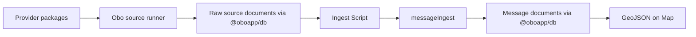

# Source adapters

`pnpm --dir ingest crawl --source <source-id>` runs one source from the instance catalog. The [runtime registry](../sources/registry.ts) checks the selected ID and loads its entrypoint. Cloud Run uses the compiled version of the same command.

The provider package discovers notices and fetches their content. Obo's [source runner](../sources/run-source.ts) checks historical identifiers, validates new content and saves complete raw records through `@oboapp/db`. Change provider requests, parsing rules and browser fixtures in [oboapp/sources](https://github.com/oboapp/sources).

## What lives here

| Code | Responsibility |
| --- | --- |
| `<source-id>/index.ts` | Connects one package to Obo. Most adapters pass its metadata and factory to the common runner. The build compiles only selected entrypoints and their imports. |
| `shared/firestore.ts` and `shared/geojson-validation.ts` | Preserve historical document ID lookups and validate geometry before storage. |
| Contract tests and fixtures | Exercise the installed package through Obo's storage and ingestion path. Historical provider screenshots serve as references. |

Of the 23 entrypoints, 13 pass the package metadata and factory directly to `createSourceCrawler`. Triaditsa runs the same steps inline. The other nine add behavior that the general runner does not supply.

| Adapters | Obo behavior |
| --- | --- |
| ERM Zapad, Sofiyska Voda, NIMH | Fail the job when every discovered item fails. An empty scan succeeds. |
| Lozenets, Oborishte | Record provider retry and recovery diagnostics. |
| Serdika | Log which provider section failed. |
| Sofia.bg | Check historical article titles and URL aliases. |
| Sensor.Community | Read the locality's stored measurements for alert evaluation. |
| Toplo | Record listing snapshots and support a database-free preview. |

The registry loads `<source-id>/index.js` by selected ID. The build and Docker checks also look for that entrypoint. Consolidating the 14 equivalent adapters would require updating these paths together and verifying that an image still loads only its selected packages. [Runtime registry](../sources/registry.ts) · [Minimal image verification](../../docs/features/source-packages.md#verifying-a-minimal-image)

For source selection, exact dependency versions and the two-source Docker check, see the [source package guide](../../docs/features/source-packages.md).

## Crawler and package contract tests

Run the adapter contracts and package-to-ingestion tests from the repository root.

```sh
pnpm --dir shared build
pnpm --dir db build
pnpm --dir ingest test:run crawlers
pnpm --dir ingest test:run handoff
```

All source directories, including currently unselected sources, have crawl-entrypoint coverage. `shared/source-inventory.test.ts` checks the explicit inventory against the implementation directories. Add a real crawl contract suite and update that inventory when adding a source; parser tests alone are insufficient.

| Suite | Contract protected |
| --- | --- |
| Each source's `index.contract.test.ts` (Sofia uses `index.test.ts`) | Source identity, locality, package output and source-specific failures |
| `shared/persistence-contract.test.ts` | Literal historical identifiers and both base64 and MD5 lookup paths |
| `sources/run-source.test.ts` | Create-only persistence, failure continuation, repeat scans, validation and cleanup |
| `erm-zapad/index.contract.test.ts` | Published ERM package through persistence and ingestion, global lowest-ID deduplication, grouped center points, geometry repair, dates, optional fields, historical lookups, failures and retry |
| `nimh-severe-weather/index.contract.test.ts` | Published NIMH package through persistence and ingestion, city-wide content, literal warning hashes, historical lookups, failures and retry |
| `messageIngest/source-handoff.test.ts` | Actual Triaditsa full-feed crawler output through persistence and `from-sources.ingest()` |
| `messageIngest/packaged-hybrid-handoff.test.ts` | Oborishte and Slatina packages through persistence and ingestion, historical lookups and retry |
| `messageIngest/packaged-toplo-handoff.test.ts` | Toplo package through persistence and ingestion, literal synthetic identifiers, legacy fields and historical lookups |
| `messageIngest/packaged-sofiyska-voda-handoff.test.ts` | Sofiyska Voda package through persistence and ingestion, synthetic identifiers, geometry, timespans, historical lookups, failures and retry |
| `messageIngest/packaged-next-districts-handoff.test.ts` | Lozenets, Studentski and Sredets packages through persistence and ingestion, historical lookups, listing failures and retry |
| `messageIngest/packaged-browser-districts-handoff.test.ts` | Ilinden, Nadezhda and Iskar published packages through persistence and ingestion, detail metadata, historical lookups, listing failures and retry |
| `messageIngest/packaged-joomla-districts-handoff.test.ts` | Mladost and Vrabnitsa published packages through persistence and ingestion, literal identifiers, provider dates, historical lookups, failures and retry |
| `messageIngest/packaged-browser-services-handoff.test.ts` | Inspectorat and SDVR packages through persistence and ingestion, literal identifiers, detail dates, historical lookups, failures and retry |
| `messageIngest/packaged-pancharevo-handoff.test.ts` | Pancharevo package through persistence and ingestion, RSS discovery, article dates, historical lookups, failures and retry |

The suites use frozen time and simulated network, browser and database boundaries. They run the real adapters, provider packages and runner. Provider parsing and air-quality calculations have their own package tests. Sofia's adapter tests cover historical title and URL matching. Sensor.Community's tests exercise the stored reading window and the native geometry handed to ingestion.

The handoff smoke suites stop at `messageIngest`, explicitly seeding downstream completion state for repeat-crawl checks. Actual message creation and processed-state updates are covered by `messageIngest/db/store-incoming-message.test.ts`; precomputed-geometry processing is covered by `messageIngest/index.test.ts`. AI and event matching have their own pipeline tests.

Preserve literal identifiers byte-for-byte. Do not derive expected identifiers using the production builder. Freeze only shared contract fields, not entire HTML responses or log output. Existing records remain known even when `processed=false`, provider content changes, or a package is upgraded. NIMH's structured-warning hash remains part of its identifier, so a changed warning can still produce a different identifier.

The runner checks both historical document ID formats before requesting a known article. It saves complete records with a create-only write so an overlapping scan cannot reset their processing state. An item that fails remains eligible on the next scan. The runner closes its source instance even when discovery fails.

## Raw records and ingestion

Every new notice has a `message` field. A package can also supply `markdownText` for display. Ingestion can use validated GeoJSON directly, including an empty FeatureCollection for a city-wide alert. For a notice that needs geocoding, ingestion filters the text, extracts locations and builds the geometry. [Message ingestion](../messageIngest/README.md)

## Running a source

Run these commands from `ingest/`. The catalog in `shared/src/sources.ts` determines which IDs appear in CLI help. `pnpm pipeline:all` runs the full selection and `pnpm pipeline:emergent` runs the sources marked `emergent: true`.

```bash
# Run a selected source
pnpm crawl --source <source-name>

# List selected sources
pnpm crawl --help
```

### Development: Cleaning Test Data

For local integration tests, the cleanup command can retain records from one source.

```bash
# Delete all unprocessed sources except lozenets-sofia-bg
pnpm sources:clean --retain lozenets-sofia-bg

# Preview what would be deleted (dry-run)
pnpm sources:clean --retain lozenets-sofia-bg --dry-run
```

**Important:** Only deletes sources that have NOT been ingested into messages. Sources with corresponding messages are always preserved.

## Data Pipeline



After a scan, the ingest command reads pending raw documents from the `sources` collection.

```bash
# Process all sources within Oborishte boundaries
pnpm ingest --boundaries localities/bg.sofia.oborishte.geojson

# Process sources from a specific crawler
pnpm ingest --source-name sofiyska-voda

# Dry run to preview
pnpm ingest --dry-run --source-name rayon-oborishte-bg
```
