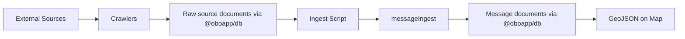

# Crawlers

Each source directory contains an entrypoint for the collection CLI and its Cloud Run job. The provider package discovers identifiers and fetches content. Obo checks historical records and saves validated content through `@oboapp/db`. The instance catalog controls which entrypoints can run. [Source package guide](../../docs/features/source-packages.md)

Maintain provider parsing, dates, identifiers and browser behavior in [oboapp/sources](https://github.com/oboapp/sources). This repository owns the runtime, database integration, job configuration and package-to-ingestion tests.

## Crawler and package contract tests

The contract tests protect historical identifiers and the handoff from each package to Obo. Run these commands from the repository root.

```sh
pnpm --dir shared build
pnpm --dir db build
pnpm --dir ingest test:run crawlers
pnpm --dir ingest test:run crawlers/erm-zapad/index.contract.test.ts
pnpm --dir ingest test:run crawlers/nimh-severe-weather/index.contract.test.ts
pnpm --dir ingest test:run messageIngest/source-handoff.test.ts
pnpm --dir ingest test:run messageIngest/packaged-hybrid-handoff.test.ts
pnpm --dir ingest test:run messageIngest/packaged-toplo-handoff.test.ts
pnpm --dir ingest test:run messageIngest/packaged-sofiyska-voda-handoff.test.ts
pnpm --dir ingest test:run messageIngest/packaged-next-districts-handoff.test.ts
pnpm --dir ingest test:run messageIngest/packaged-browser-districts-handoff.test.ts
pnpm --dir ingest test:run messageIngest/packaged-joomla-districts-handoff.test.ts
pnpm --dir ingest test:run messageIngest/packaged-browser-services-handoff.test.ts
pnpm --dir ingest test:run messageIngest/packaged-pancharevo-handoff.test.ts
```

All source directories, including currently unselected sources, have crawl-entrypoint coverage. `shared/source-inventory.test.ts` checks the explicit inventory against the implementation directories. Add a real crawl contract suite and update that inventory when adding a source; parser tests alone are insufficient.

| Suite | Contract protected |
| --- | --- |
| Each source's `index.contract.test.ts` (Sofia uses `index.test.ts`) | Source identity, locality, package output and source-specific failures |
| `shared/persistence-contract.test.ts` | Literal historical identifiers and both base64 and MD5 lookup paths |
| `sources/run-source.test.ts` | Create-only persistence, failure continuation, repeat scans, validation and cleanup |
| `erm-zapad/index.contract.test.ts` | Published ERM package through persistence and ingestion, global lowest-ID deduplication, grouped center points, geometry repair, dates, optional fields, historical lookups, failures and retry |
| `nimh-severe-weather/index.contract.test.ts` | Published NIMH package through persistence and ingestion, city-wide content, literal warning hashes, historical lookups, failures and retry |
| `messageIngest/source-handoff.test.ts` | Actual Triaditsa full-feed crawler output through persistence and `from-sources.ingest()` |
| `messageIngest/packaged-hybrid-handoff.test.ts` | Oborishte and Slatina packages through persistence and ingestion, historical lookups and retry |
| `messageIngest/packaged-toplo-handoff.test.ts` | Toplo package through persistence and ingestion, literal synthetic identifiers, legacy fields and historical lookups |
| `messageIngest/packaged-sofiyska-voda-handoff.test.ts` | Sofiyska Voda package through persistence and ingestion, synthetic identifiers, geometry, timespans, historical lookups, failures and retry |
| `messageIngest/packaged-next-districts-handoff.test.ts` | Lozenets, Studentski and Sredets packages through persistence and ingestion, historical lookups, listing failures and retry |
| `messageIngest/packaged-browser-districts-handoff.test.ts` | Ilinden, Nadezhda and Iskar published packages through persistence and ingestion, detail metadata, historical lookups, listing failures and retry |
| `messageIngest/packaged-joomla-districts-handoff.test.ts` | Mladost and Vrabnitsa published packages through persistence and ingestion, literal identifiers, provider dates, historical lookups, failures and retry |
| `messageIngest/packaged-browser-services-handoff.test.ts` | Inspectorat and SDVR packages through persistence and ingestion, literal identifiers, detail dates, historical lookups, failures and retry |
| `messageIngest/packaged-pancharevo-handoff.test.ts` | Pancharevo package through persistence and ingestion, RSS discovery, article dates, historical lookups, failures and retry |

The suites use frozen time and simulated network, browser and database boundaries. They run the real adapters, provider packages and runner. Provider parsing and air-quality calculations have their own package tests. Sofia's adapter tests cover historical title and URL matching. Sensor.Community's tests exercise the stored reading window and the native geometry handed to ingestion.

The handoff smoke suites stop at `messageIngest`, explicitly seeding downstream completion state for repeat-crawl checks. Actual message creation and processed-state updates are covered by `messageIngest/db/store-incoming-message.test.ts`; precomputed-geometry processing is covered by `messageIngest/index.test.ts`. AI and event matching have their own pipeline tests.

Preserve literal identifiers byte-for-byte. Do not derive expected identifiers using the production builder. Freeze only shared contract fields, not entire HTML responses or log output. Existing records remain known even when `processed=false`, provider content changes, or a package is upgraded. NIMH's structured-warning hash remains part of its identifier, so a changed warning can still produce a different identifier.

The runner checks both historical document ID formats before requesting a known article. It saves complete records with a create-only write so an overlapping scan cannot reset their processing state. An item that fails remains eligible on the next scan. The runner closes its source instance even when discovery fails.

Before considering a PR ready, check every applicable CI job and available Sonar findings for changed files, including the actual quality gate. State when Sonar results are unavailable. A green gate does not necessarily mean there are no new issues. Keep test declarations explicit in each `.test.ts` file so static analysis can recognize them; shared mock/assertion support belongs under `__mocks__`.

## Provider pages and fixtures

Some source directories contain historical listing and article screenshots named `_entry.png` and `_message.png`. When a provider redesign changes the extraction rules, update the parser and its fixtures together in the provider package.

## Crawler Architecture

District packages manage browser sessions, parse feeds and listings, extract publication dates and convert articles to Markdown. Obo's runner checks historical records and saves new ones.

API sources use provider-specific request and parsing logic.

ERM Zapad's entrypoint calls the published HTTP factory through the runner. Its package collects every municipality before global pin deduplication selects historical incident identifiers, with a two-second delay between municipality requests. Obo keeps historical lookups, geometry validation, complete raw persistence and ingestion. The entrypoint fails when all discovered incidents fail; empty scans succeed. Its emergent classification remains unchanged.

### Markdown Text Handling

Crawlers handle message formatting differently based on whether they provide precomputed GeoJSON:

**Crawlers with precomputed GeoJSON** (utility APIs, weather services):

- Skip the AI filtering and extraction pipeline
- Must store formatted text in both `message` and `markdownText` fields
- **City-wide messages**: Set `cityWide: true` with empty FeatureCollection for alerts applying to the entire city

**Crawlers without GeoJSON** (municipality websites):

- Go through the full AI extraction pipeline
- Store HTML content converted to markdown in `message` field only
- The AI filter & split stage produces `markdownText` for display

## Running Crawlers

Run the following commands from `ingest/`.

The `crawl` and `pipeline` commands share a [runtime registry](../sources/registry.ts) derived from `SOURCES` in `shared/src/sources.ts`. Only selected IDs appear in help and can run through these commands. An unselected source directory is rejected. `pipeline --all` runs every selected source; `pipeline --emergent` runs selected sources marked `emergent: true`.

The production build starts from selected crawler entrypoints and follows their imports, including shared helpers. It clears previous compiled output, and the image omits the raw crawler source tree. Docker removes unselected provider dependencies from copied manifests and the matching frozen lockfile before builder and runtime installation. Development manifests retain integration dependencies for tests. See the [selected-build guidance](../../docs/features/source-packages.md#building-selected-sources) and [production dependency guidance](../../docs/features/source-packages.md#preparing-production-dependencies) for the preparation steps.

The independent `Test Minimal Source Image` CI job builds a copied context with only Triaditsa, Sofiyska Voda and shared helpers. It checks selected packages in both the builder and runtime images, compiled source directories and offline startup as the production user. Selected entrypoints load without invoking collection, database initialization or browser runtimes. See the [minimal-image instructions](../../docs/features/source-packages.md#verifying-a-minimal-image) for local commands and deployment boundaries.

```bash
# Run a selected source
pnpm crawl --source <source-name>

# List selected sources
pnpm crawl --help
```

### Development: Cleaning Test Data

When developing a new crawler, you may want to clear test data from other sources while keeping your crawler's data:

```bash
# Delete all unprocessed sources except lozenets-sofia-bg
pnpm sources:clean --retain lozenets-sofia-bg

# Preview what would be deleted (dry-run)
pnpm sources:clean --retain lozenets-sofia-bg --dry-run
```

**Important:** Only deletes sources that have NOT been ingested into messages. Sources with corresponding messages are always preserved.

## Data Pipeline



After crawlers store raw documents in the `sources` collection, use the ingest script to process them:

```bash
# Process all sources within Oborishte boundaries
pnpm ingest --boundaries localities/bg.sofia.oborishte.geojson

# Process sources from a specific crawler
pnpm ingest --source-name sofiyska-voda

# Dry run to preview
pnpm ingest --dry-run --source-name rayon-oborishte-bg
```

The ingest script runs each source through the [messageIngest](../messageIngest) pipeline to extract addresses, geocode locations, and generate map-ready GeoJSON features.
